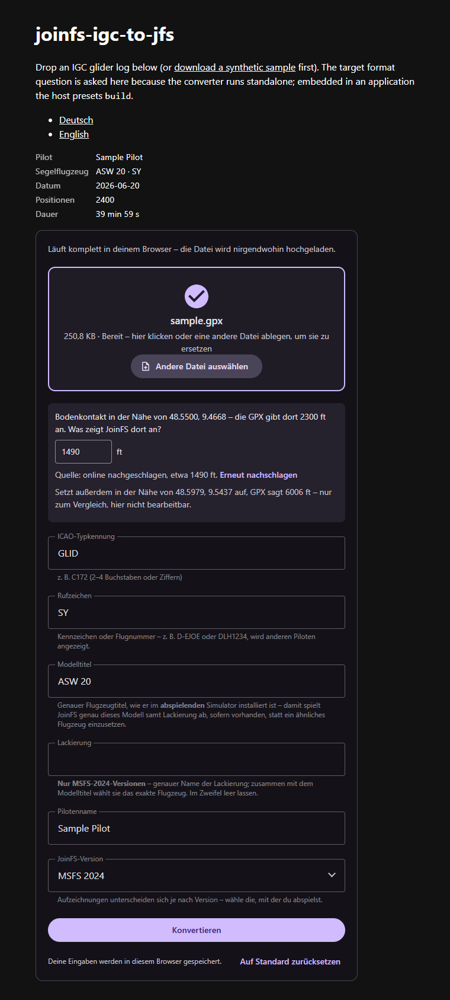

# Languages

English is built into the script. Every other language is a JSON file next to the script, named
`joinfs-igc-to-jfs-<locale>.json`:

| Code | Language |
|---|---|
| `en` | English (in the script) |
| `de` | Deutsch |
| `es` | Español |
| `fr` | Français |
| `it` | Italiano |
| `ko` | 한국어 |
| `nl` | Nederlands |
| `pt` | Português |
| `uk` | Українська |

These are the languages JoinFS itself ships, plus Ukrainian.

## How the language is chosen

1. the element's **`lang` attribute**, which is observed: set it at any time and everything re-renders;
2. otherwise the **browser's languages** (`navigator.languages`), in order, the first supported one wins;
3. otherwise English.

Regional tags count as their main language (`de-AT` is `de`, `pt-BR` is `pt`). The component does **not** read the page
address; the demo page maps `?lang=de` onto the attribute, and you can do the same on your page.

The converter inside (the GPX converter) follows the same language.

## Hosting the files

Keep the JSON files in the same folder as `joinfs-igc-to-jfs.js`, or set `locale-base` to their folder. A file is fetched
once per page, when its language is first needed. If a file cannot be loaded (for example when the page is opened as a
`file://` page), the console says which URL failed and why, and the component continues in English. A missing translation
falls back to English as well; nothing breaks.

## Adding a language

1. Copy `src/joinfs-igc-to-jfs-de.json` to `src/joinfs-igc-to-jfs-<code>.json` and translate the values. Keep the keys and
   the `{placeholders}` exactly as they are; the placeholders are filled in as they are, so write sentences around a plain
   number or noun.
2. Add the code to `SUPPORTED` in `src/joinfs-igc-to-jfs.js` and to `LOCALES` in `test/locales.test.js`.
3. Run `npm test`: the locale test checks that every file has exactly the English keys and placeholders.

(The files are generated from the table in `tools/make-locales.cjs`.) The German texts use the informal "du". The other
translations are first drafts; corrections are welcome as pull requests or issues.
