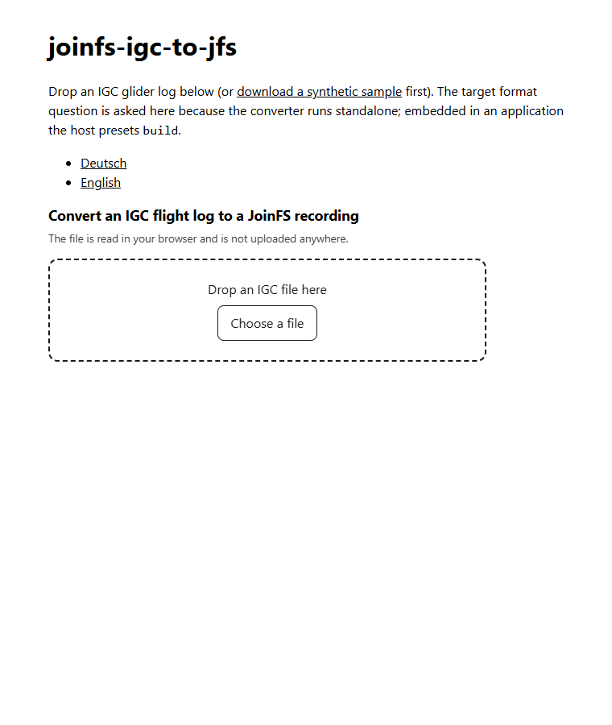
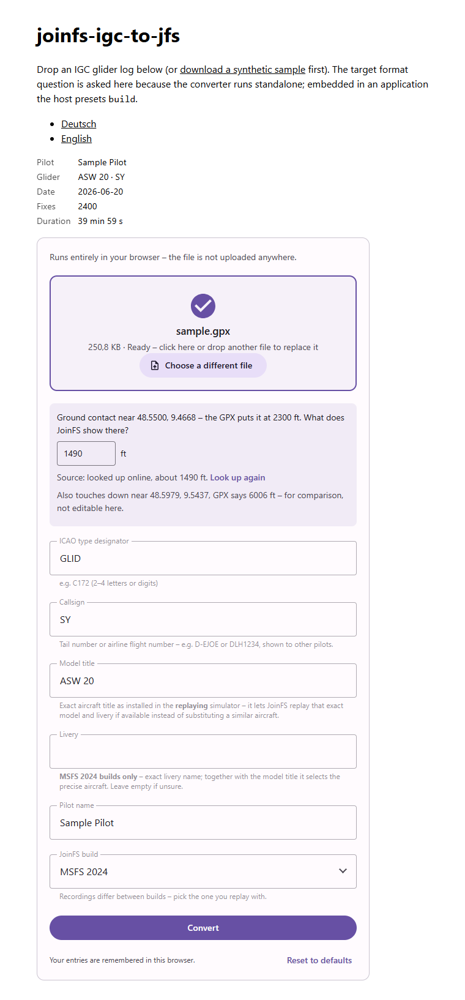

# Using the Converter

## 1. Open the page

Use the demo (`demo/index.html`, see [Embedding in a Page](Embedding-in-a-Page#run-the-demo)) or any page that embeds
`<joinfs-igc-to-jfs>`.

## 2. Add your flight log

Drag an `.igc` file onto the drop area, or press **Choose a file**. IGC files come from your flight recorder or from
flight-logging services (look for "download IGC").

The file is read in the browser. It is **not uploaded**.

## 3. Check the summary

The summary above the form shows what was found: **pilot**, **glider** (type and competition id or registration),
**date**, number of **fixes** (GPS positions) and the **duration**. If the log has no GPS altitude, a note says the
pressure altitude is used.

If something is wrong with the file, a red message says what (not an IGC file, no fixes, missing date, ...). Choose
another file to try again.

## 4. Review the form

The fields are prefilled from the IGC header; change anything that is not right.

| Field | Prefilled from | Notes |
|---|---|---|
| ICAO type designator | `GLID` | the generic glider designator; enter a specific one such as `AS21` if you know it |
| Callsign | competition id, else glider id | what other pilots see |
| Model title | glider type | the exact aircraft title installed in the replaying simulator makes JoinFS replay that model |
| Livery | (empty) | MSFS 2024 builds only; leave empty if unsure |
| Pilot name | pilot | |
| JoinFS build | | asked **only when the converter runs on its own**; embedded in an application the host usually decides this |

The aircraft category is set to *glider* without asking. The form also shows the converter's usual helpers: an
elevation check at the place the flight touches the ground, and hints when the track looks odd.

## 5. Convert and download

Press **Convert**. The recording is offered for download as `<name>.jfs`; put it in JoinFS's recordings folder and replay
it from JoinFS.

## Tips

- **Thermalling and gliding look right** because speeds and attitude are derived from the positions like for any GPX track.
- **Long flights** work; the converter refuses only extreme cases (too many points) and says so.
- Several flights: convert them one after the other, or load them together in the
  [JoinFS Recording Toolkit](https://github.com/joeherwig/JoinFS-recording-toolkit), which can line them up in time.
- **Language:** the page language follows your browser; see [Languages](Languages).
